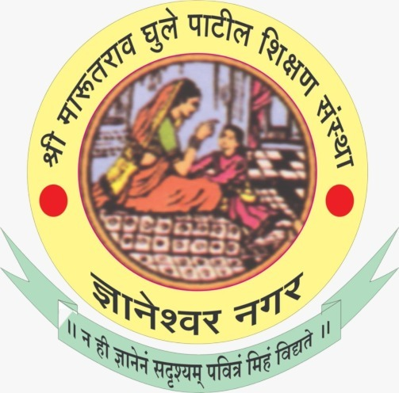
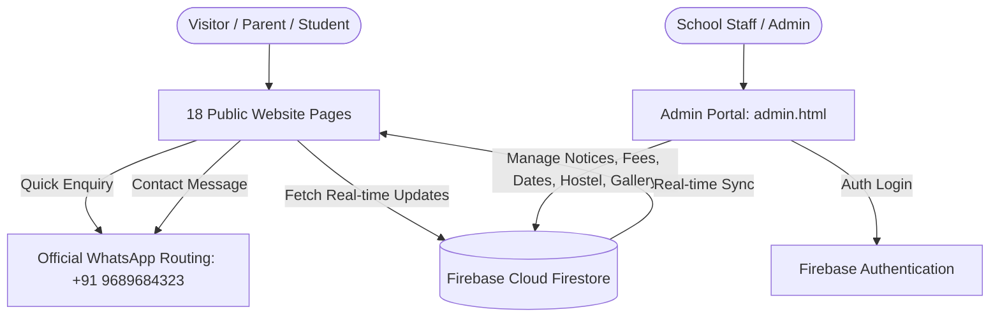

<div align="center">

  

  # 🏫 JIJAMATA PUBLIC SCHOOL
  ### *Shri Marutrao Ghule Patil Shikshan Sanstha's*
  **Bhenda Budruk, Taluka Nevasa, District Ahilyanagar, Maharashtra — Est. 2003**
  
  <p align="center">
    <strong>CBSE Pattern • LKG to 10th Standard • NEP 2020 Aligned • Residential Hostel Facilities</strong>
  </p>

  <!-- Shields & Badges -->
  <p align="center">
    
    
    
    
    
  </p>

  <p align="center">
    <a href="#-quick-navigation">Explore Features</a> •
    <a href="#-interactive-page-directory">Page Directory</a> •
    <a href="#-staff-admin-portal-adminhtml">Admin Portal</a> •
    <a href="#-whatsapp-automation">WhatsApp Integration</a> •
    <a href="#-installation--local-run">Run Locally</a> •
    <a href="#-school-contact--location">Contact</a>
  </p>

</div>

---

## 📌 Quick Navigation

- [🌟 Key Architectural Highlights](#-key-architectural-highlights)
- [📱 Mobile-First User Experience](#-mobile-first-user-experience)
- [🔐 Staff Admin Portal (`admin.html`)](#-staff-admin-portal-adminhtml)
- [📲 Direct WhatsApp Routing](#-direct-whatsapp-routing)
- [🔥 Firebase Dynamic Synchronization](#-firebase-dynamic-synchronization)
- [🗂️ Interactive Page Directory](#️-interactive-page-directory)
- [🎨 Design System & Palette](#-design-system--palette)
- [🚀 Installation & Local Run](#-installation--local-run)
- [📞 School Contact & Location](#-school-contact--location)

---

## 🌟 Key Architectural Highlights



<details open>
<summary><b>✨ Feature Overview (Click to expand / collapse)</b></summary>
<br>

- **⚡ Interactive Hero Slider:** Custom React carousel component with authentic pamphlets, founders homage, and government initiatives.
- **🔐 Staff Admin Portal (`admin.html`):** Role-authenticated staff dashboard for managing Notices, Fee Structures, Admission Dates, Academic Calendars, Hostel Routines, and Event Gallery uploads.
- **🖼️ Real-Time Photo Gallery with Auto-Compression:** Upload images directly from any smartphone; client-side HTML5 canvas automatically optimizes files down to ~100–200 KB with instant preview.
- **📲 Direct WhatsApp Integration:** One-click WhatsApp enquiry routing for Admissions & Contact with pre-filled details and automatic lead backup in Firestore.
- **🏨 Hostel Information & Daily Routine:** Comprehensive residential facility information with an interactive schedule table editable directly from the Admin Portal.
- **⚖️ Government Admission Schemes:** Detailed guidance on **RTE (Right to Education)** and **Raje Yashwantrao Holkar Schemes** for eligible students.
- **🔍 Global Search Modal:** Fast client-side fuzzy search across fees, admissions, hostel, academics, and circulars.

</details>

---

## 📱 Mobile-First User Experience

The website is engineered for seamless viewing on smartphones, tablets, and desktops:

- **Single-Line Executive Top Bar:** Sticky notice ticker displaying live updates, emergency contacts, WhatsApp link, and YouTube channel.
- **Zero-Gap Header Elevation:** Modern border-bottom and multi-layer drop shadow separating the sticky navbar from page content without awkward empty gaps.
- **Touch-Friendly Drawer Navigation:** Slide-out drawer with active dropdown accordions and smooth backdrop blur.
- **Mobile-Responsive Tables:** Fee structures, academic calendars, and daily routines feature edge-to-edge layouts, readable typography, and horizontal touch scrolling.

---

## 🔐 Staff Admin Portal (`admin.html`)

A dedicated management portal for school administrators and staff.

```
Access URL: admin.html
Default Role: Staff Administrator
```

### Management Modules:

| Module | Description | Live Sync Target |
|---|---|---|
| **📢 Notices & Announcements** | Post, pin, or delete circulars and important news with category tags. | [notices.html](notices.html), [index.html](index.html) |
| **💰 School Fee Structure** | Update class-wise tuition, term, and annual fees. | [admissions.html](admissions.html) |
| **📅 Admission Dates** | Manage admission start dates, form submission deadlines, and verification schedules. | [admissions.html](admissions.html) |
| **🗓️ Academic Calendar** | Maintain event dates, term schedules, exam periods, and celebrations. | [academics.html](academics.html) |
| **🏨 Hostel Daily Routine** | Edit wake-up, study hours, sports time, and dinner timings. | [hostel.html](hostel.html) |
| **📸 Event Photo Gallery** | Upload photos with automatic device compression (~100–200 KB) and category filters. | [gallery.html](gallery.html) |

---

## 📲 Direct WhatsApp Routing

Both public enquiry channels connect directly to the school's official WhatsApp number (**+91 9689684323**):

```text
┌────────────────────────┐       ┌────────────────────────┐
│  Quick Admission Form  │  ───> │  WhatsApp Pre-filled:  │
│  (Parent / Student)    │       │  • Student Name        │
└────────────────────────┘       │  • Mobile Number       │
                                 │  • Grade Seeking       │
┌────────────────────────┐       └────────────────────────┘
│   Contact Us Form      │  ───> │  WhatsApp Pre-filled:  │
│   (General Visitors)   │       │  • Full Name & Email   │
└────────────────────────┘       │  • Subject & Message   │
                                 └────────────────────────┘
```

> **Lead Safety:** Every submission is simultaneously archived in the background to Firebase Firestore (`admission_enquiries` and `contact_messages`).

---

## 🔥 Firebase Dynamic Synchronization

- **Script:** [`js/dynamic-content.js`](js/dynamic-content.js)
- **Zero-Latency Fallback:** If offline or if cloud limits are reached, the site smoothly displays cached/static fallback content so visitors never see empty pages.
- **Real-Time Listeners:** Changes made in `admin.html` reflect immediately on public pages without requiring file edits or redeployments.

---

## 🗂️ Interactive Page Directory

| Page | File | Purpose |
|---|---|---|
| **Homepage** | [`index.html`](index.html) | Hero slider, founders legacy, admission query, key stats, campus overview |
| **About Us** | [`about.html`](about.html) | School history, Sanstha mission, founders profile, principal's desk |
| **Academics** | [`academics.html`](academics.html) | Curriculum, NEP 2020 alignment, examination system, academic calendar |
| **Academic Sections** | [`departments.html`](departments.html) | Pre-Primary (LKG/UKG), Primary (1st–4th), Middle (5th–7th), Secondary (8th–10th) |
| **Admissions** | [`admissions.html`](admissions.html) | Admission procedure, eligibility criteria, required documents, fee table |
| **Hostel Facilities** | [`hostel.html`](hostel.html) | Residential dorms, mess & nutrition, study hall, live daily routine |
| **Photo Gallery** | [`gallery.html`](gallery.html) | Filterable event gallery (Campus, Labs, Sports, Cultural, Celebrations) |
| **Notices & Circulars**| [`notices.html`](notices.html) | School notice board with category badges and archived circulars |
| **Government Schemes**| [`schemes.html`](schemes.html) | Free admission information under RTE Act and Raje Yashwantrao Holkar Scheme |
| **Contact Us** | [`contact.html`](contact.html) | Location map, telephone, email, office hours, and WhatsApp inquiry form |
| **Co-Curricular** | [`activities.html`](activities.html) | Holistic student development overview |
| **Sports & Athletics**| [`sports-athletics.html`](sports-athletics.html) | Sports infrastructure, annual athletic meets, outdoor/indoor games |
| **Cultural Events** | [`cultural-events.html`](cultural-events.html) | Annual Day, festivals, competitions, drama, music |
| **Science Exhibition**| [`science-exhibition.html`](science-exhibition.html) | Science laboratories, innovation fairs, experimental models |
| **Art & Craft** | [`art-craft.html`](art-craft.html) | Creative arts, painting, drawing, sculpture, exhibitions |
| **Staff Admin** | [`admin.html`](admin.html) | Administrative CMS for managing notices, fees, dates, and photos |
| **Student Portal** | [`student-login.html`](student-login.html) | Student login & dashboard interface |
| **Teacher Portal** | [`teacher-login.html`](teacher-login.html) | Teacher portal authentication |

---

## 🎨 Design System & Palette

The design reflects the prestigious legacy and natural surroundings of Jijamata Public School:

| Color Token | Hex Code | Role | Sample |
|---|---|---|---|
| `--accent-dark` | `#4F5B2A` | Primary Brand Olive Green (Header, Badges, Dark accents) | `■■■■■` |
| `--accent` | `#6B7A3A` | Supporting Olive Leaf (Buttons, Highlights) | `■■■■■` |
| `--accent-tint` | `#E4E8D0` | Subtle Notice Tint (Notice bar background) | `■■■■■` |
| `--gold` | `#B8923A` | Prestigious Gold (Borders, Star Icons, Callouts) | `■■■■■` |
| `--bg` | `#FAF7F0` | Warm School Cream Page Background | `■■■■■` |
| `--bg-alt` | `#F1EADB` | Alternate Card & Section Cream | `■■■■■` |
| `--text-strong`| `#25231C` | Deep Charcoal Heading Typography | `■■■■■` |

- **Headings Font:** `Poppins`, sans-serif (Weights: 600, 700, 800)
- **Body Font:** `Inter`, -apple-system, sans-serif (Weights: 400, 500, 600)

---

## 🚀 Installation & Local Run

To preview or run the website locally:

```bash
# 1. Clone the repository
git clone https://github.com/Krushna018/Jijamata-Public-School-Bhenda-Website.git

# 2. Navigate to the project directory
cd Jijamata-Public-School-Bhenda-Website

# 3. Start a local HTTP server (using Python)
python -m http.server 8086

# 4. Open in your favorite browser
http://localhost:8086
```

---

## 📞 School Contact & Location

<div align="center">

| Channel | Official Details |
|---|---|
| 📍 **Address** | **Jijamata Public School**, Bhenda Budruk, Taluka Nevasa, District Ahilyanagar, Maharashtra – 414605 |
| 📞 **Telephone** | **02427-295701** / **+91 9689684323** |
| 💬 **WhatsApp** | [Chat on WhatsApp (+91 9689684323)](https://wa.me/919689684323) |
| ✉️ **Email** | [jpsbhenda@gmail.com](mailto:jpsbhenda@gmail.com) |
| 📺 **YouTube** | [@jijamatapublicschool5042](https://youtube.com/@jijamatapublicschool5042?si=lji02YHtw350a3C7) |
| 🗺️ **Google Maps** | [View on Google Maps](https://www.google.com/maps/search/?api=1&query=Jijamata+Public+School,+Bhenda+Budruk,+Taluka+Nevasa,+District+Ahilyanagar,+Maharashtra) |

<br>

<p align="center">
  <b>© 2026 JIJAMATA PUBLIC SCHOOL. All Rights Reserved.</b><br>
  <i>Empowering students with value-based education since 2003.</i>
</p>

</div>
